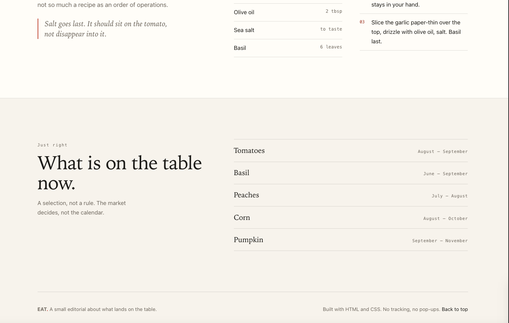
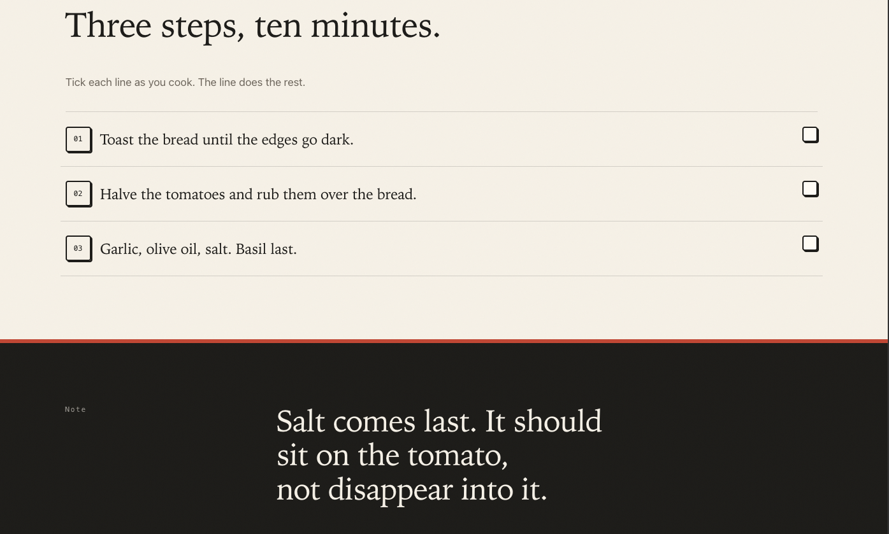
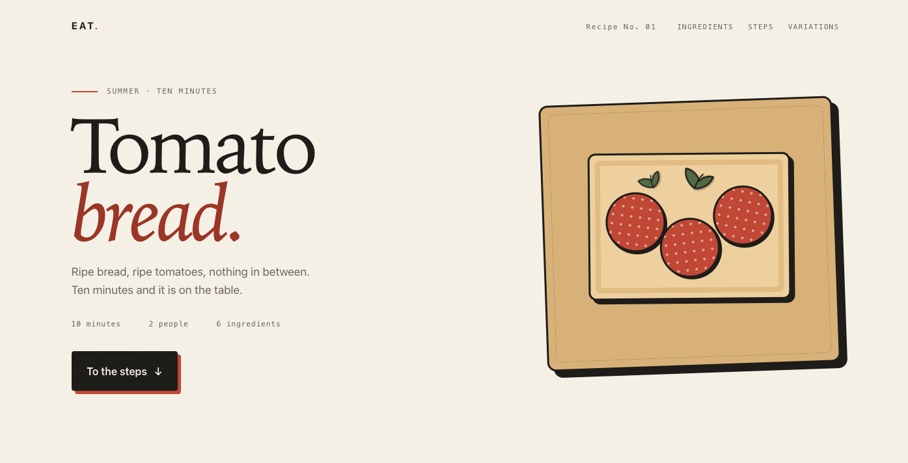

# Greatui

**Greatui makes AI-built pages look designed instead of generated.**

You say what you're building — a landing page, a dashboard, a portfolio — and before any code exists it locks the things that make a page look cheap when they're left to the model: the feel, the type scale, the colours, the motion, and one detail worth remembering. Your agent then builds against that instead of guessing.

**Before:**

  
  
  

**After:**

  
  
  

## What it actually fixes

- **Landing page?** It picks the archetype, the one promise, the fold anatomy and the single accent — so you don't get another purple SaaS hero.
- **Dashboard?** It defines states, density and one accent that means "current", not five colours that mean nothing.
- **Portfolio?** It forces one signature and keeps everything else quiet.

## How it works

1. **Brief or questionnaire.** One sentence is enough. If you'd rather answer, you get seven clickable questions — one per axis, never a wall of text.
2. **Five decisions, in order.** Each one narrows the next, so the result can't end up as five unrelated good ideas.

   | Axis | Decides | Example |
   |---|---|---|
   | Feeling | temperament, motion intensity | calm and precise, 2/10 |
   | Material | depth, radii, shadows | flat and framed, 8 / 12 / 16 px |
   | Colour | neutral ramp + exactly one accent | off-black + lime |
   | Motion | duration, curve, stagger | 200 ms hover, 500 ms panel |
   | Signature | the one mechanic people remember | "every confirmation is drawn" |

3. **A `DESIGN.md` your agent can't misread.** Colour tokens with measured contrast, a type ladder, component states, a motion table, accessibility gates, and one signature that has to survive a greyscale and a reduced-motion test.

## What's in the file

Twelve sections, all decisions, no mood-board prose:

`0` Brief & non-goals · `1` Personality · `2` Colour tokens · `3` Typography · `4` Material & depth · `5` Motion · `6` The signature · `7` Components & states · `8` Layout · `9` State matrix · `10` Accessibility gates · `11` Anti-patterns · `12` Implementation

## Use

> Build a landing page for a satellite company. Dark, precise, expensive. No SaaS purple.

Greatui answers with a five-line brief, then writes `DESIGN.md` into the project. From there your build agent works against that file instead of improvising — and every later page in the same project starts from the same system.

## What it won't do

- Invent metrics, clients or testimonials. Placeholders stay placeholders.
- Build a component library. It defines the states of the components your brief actually needs.

